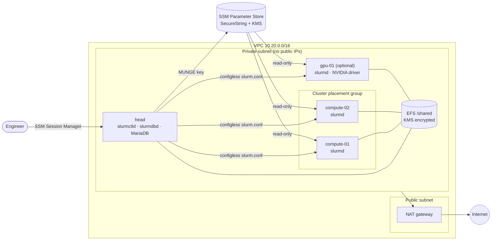

# slurm-aws-terraform

[](https://github.com/Engdarwish2019/slurm-aws-terraform/actions/workflows/ci.yml)


A Slurm HPC cluster on AWS, built with Terraform. One `terraform apply` gives you a head node
with job accounting, CPU compute nodes in a cluster placement group, an optional NVIDIA GPU
partition and a shared EFS file system. There is no SSH and no public IP on any node: you get in
through AWS Systems Manager.

## Architecture



| Component | What it does |
|---|---|
| `head` | `slurmctld`, `slurmdbd` and MariaDB (localhost only). Generates the MUNGE key at first boot. |
| `compute-NN` | CPU nodes running `slurmd` in **configless** mode: they pull `slurm.conf`, `cgroup.conf` and `gres.conf` from the controller. |
| `gpu-NN` | Optional GPU partition (default `g5.xlarge`, 1x A10G). NVIDIA driver from the official CUDA repo, `Gres=gpu`, device isolation with cgroups. |
| EFS | Mounted at `/shared` on every node: user homes (`/shared/home`) and shared software (`/shared/apps`). |
| KMS key | One customer-managed key (rotation on) for EBS, EFS, the MUNGE key parameter and flow logs. |

## Design decisions

- **Secrets never touch code or Terraform state.** The head node creates the MUNGE key at boot and
  stores it as an SSM `SecureString`. Terraform only creates a placeholder (`ignore_changes`), compute
  nodes have read-only IAM access to that one parameter. The accounting DB password is generated on
  the head node and only lives in `slurmdbd.conf` (mode 0600).
- **Configless Slurm.** Only the head node holds `slurm.conf`. Adding nodes does not rebuild the existing
  ones, and `scripts/push-slurm-conf.sh` updates the controller through SSM Run Command.
- **Node shapes come from AWS.** CPU, core, thread and memory values in `slurm.conf` are read from the
  `aws_ec2_instance_type` data source, so changing the instance type keeps Slurm's node definition correct.
- **Least privilege network.** Default security group is emptied, nodes talk to each other freely,
  egress is limited to HTTP/HTTPS and NFS to EFS, and the EFS mount target only accepts NFS from the nodes.
- **Bad nodes take themselves out.** slurmd runs `node-healthcheck` every 5 minutes. A lost `/shared`
  mount, broken MUNGE, a missing GPU, uncorrectable ECC errors, a pending row remap or a critical XID
  (79 "fallen off the bus", 48 and 94/95 ECC, 119/120 GSP firmware...) drains the node with a
  `healthcheck:` reason, so no new job lands on broken hardware. When the checks pass again the node is
  resumed, but only if the script drained it, never a node an administrator drained by hand.
- **Self-healing and alerting.** Every node has a CloudWatch alarm on the EC2 system status check:
  EBS-only nodes are recovered automatically (same ID, IP and volumes on healthy hardware), while
  instance types with local disks, such as g5, notify instead because EC2 cannot recover them. The
  head node reboots itself if its OS hangs. These alarms, EFS approaching its I/O limit and AWS
  Health notices for EC2 (scheduled maintenance, retirement) all go to one KMS-encrypted SNS
  topic; set `alert_email` to subscribe.
- **SELinux stays enforcing**, IMDSv2 is required, all volumes are encrypted with the cluster key and
  VPC flow logs go to an encrypted CloudWatch log group.

## Usage

Requirements: Terraform 1.6+, AWS CLI v2 and the
[Session Manager plugin](https://docs.aws.amazon.com/systems-manager/latest/userguide/session-manager-working-with-install-plugin.html).

```bash
cp terraform.tfvars.example terraform.tfvars   # adjust region, sizes, GPU count
terraform init
terraform apply

# open a shell on the head node (first boot takes ~5-10 minutes)
$(terraform output -raw connect)
sudo tail -f /var/log/hpc-bootstrap.log
```

Run the examples as the cluster user:

```bash
sudo -iu hpcuser
sinfo
cd ~/examples && sbatch hello.sbatch     # pre-installed: 2 nodes x 2 tasks
sacct --format=JobID,JobName,State,Elapsed,AllocTRES%40
```

The MPI and GPU job scripts are in [`examples/`](examples). Create them in the user's home
(it lives on `/shared`, so every node sees it), build the MPI program once with `mpicc`, and
submit with `sbatch`.

### Resizing

```bash
terraform apply -var compute_node_count=4
./scripts/push-slurm-conf.sh    # pushes the new slurm.conf and restarts slurmctld
```

### Remote state

Copy `backend.tf.example` to `backend.tf` to keep state in an encrypted S3 bucket with locking.

### Clean up

```bash
terraform destroy
```

The NAT gateway, EFS and instances are billed per hour, so destroy the lab when you are done.

## Validating the cluster

Checks and benchmarks for bringing up a cluster or a new GPU node. Copy the folders from
[`examples/`](examples) into the cluster user's home (on `/shared`) and submit them as normal jobs:

| What | How | Shows |
|---|---|---|
| Node health | Automatic: `HealthCheckProgram` in `slurm.conf` runs `modules/cluster/files/node-healthcheck.sh` | Nodes with broken storage, authentication or GPUs are drained (`sinfo -R`) |
| GPU isolation | `sbatch gpu.sbatch` | A job sees only the GPU it was given (cgroup `ConstrainDevices`) |
| GPU communication | `srun -p gpu -N 1 --gres=gpu:1 nccl/build-nccl-tests.sh`, then `sbatch nccl/nccl-tests.sbatch` | NCCL all-reduce across nodes with correct results, and the bus bandwidth to compare between runs |
| CPU performance | `hpl/build-hpl.sh`, then `cd hpl && sbatch hpl.sbatch` | HPL (LINPACK) sized to 70% of memory on a near-square process grid: Gflops plus the residual check (`PASSED`) |
| MPI | `sbatch mpi/mpi.sbatch` | Ranks start on every node through Slurm |

The nccl-tests and HPL sources are pinned and verified against a SHA-256 checksum before they are
built. GPU nodes install the CUDA toolkit and NCCL for this (`gpu_cuda_toolkit = true`, the default).

```bash
sinfo -R                                  # drain reasons, health check ones start with "healthcheck:"
sudo journalctl -t node-healthcheck -f    # on a node: what the check found
```

## CI

Every push runs:

| Job | Tools |
|---|---|
| Terraform | `terraform fmt -check`, `terraform validate`, `tflint` (AWS ruleset) |
| Security | `checkov` (results uploaded to GitHub code scanning), `gitleaks` |
| Scripts | `shellcheck` on helper scripts, the node health check and every job example |
| HPL | Builds HPL with `examples/hpl/build-hpl.sh` in Rocky Linux 9, runs it with Open MPI and requires the residual check to pass |
| nccl-tests | Compiles nccl-tests with `examples/nccl/build-nccl-tests.sh` in NVIDIA's CUDA 13 Rocky Linux 9 image (compiling needs no GPU) |

## Repository layout

```text
.
├── main.tf / kms.tf / security.tf    root module: wiring, KMS key, security groups
├── operations.tf                     alerts topic, EFS alarm, AWS Health events
├── modules/
│   ├── network/                      VPC, subnets, NAT, flow logs
│   ├── storage/                      EFS + backup policy
│   └── cluster/                      instances, IAM, SSM parameter, Slurm templates, EC2 alarms,
│                                     node health check (files/node-healthcheck.sh)
├── examples/                         jobs: hello, MPI, GPU, NCCL tests, HPL
└── scripts/push-slurm-conf.sh        day-2 config push through SSM
```

## Related projects

- [ansible-hpc-roles](https://github.com/Engdarwish2019/ansible-hpc-roles): the same stack as reusable Ansible roles, for on-prem or bare metal.
- [slurm-observability](https://github.com/Engdarwish2019/slurm-observability): Prometheus, Grafana and alerts for Slurm and GPUs.

## License

MIT
